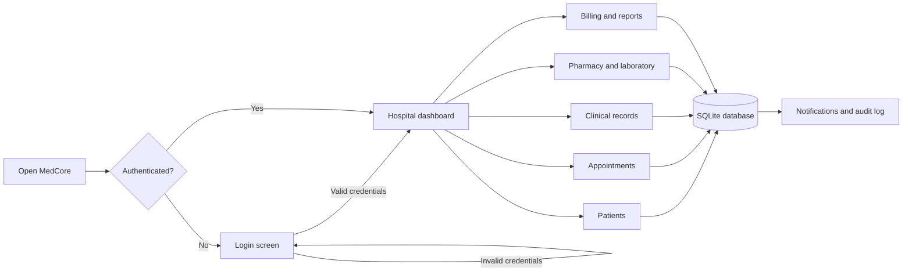

# MedCore HMS

<p align="center">
  
</p>

<p align="center">
  <strong>A clean, lightweight hospital management workspace for everyday clinical operations.</strong>
</p>

<p align="center">
  <a href="https://github.com/omsatote/medcore-internship">Repository</a> ·
  <a href="#quick-start">Quick start</a> ·
  <a href="#working-flow">Working flow</a> ·
  <a href="#deployment">Deployment</a>
</p>

---

## Overview

MedCore HMS is a dependency-free hospital management system built for a
simple, fast local setup. It provides a dashboard for hospital administrators
to manage patients, appointments, medical records, prescriptions, laboratory
orders, pharmacy inventory, billing, staff, beds, analytics, and hospital
settings.

The project is intentionally small and easy to understand:

- **Python standard library backend** with no third-party packages
- **SQLite database** for local persistence
- **Responsive browser interface** served from the same Python process
- **Simple login screen** with demo administrator credentials
- **JSON API** used by the dashboard

## Features

| Area | Included capabilities |
| --- | --- |
| Dashboard | Patient count, appointments, revenue, bed occupancy, and recent activity |
| Patients | Register and search patients by name, phone, or email |
| Appointments | Book appointments and update appointment status |
| Clinical records | Store diagnoses, notes, vitals, and treatment plans |
| Prescriptions | Record medicines, dosage, frequency, duration, and instructions |
| Laboratory | Create lab orders and track results and status |
| Pharmacy | View medicine stock, expiry dates, reorder levels, and prices |
| Billing | Create invoices and mark them as pending, paid, or cancelled |
| Hospital operations | Manage doctors, staff, beds, and hospital settings |
| Auditability | Notifications and audit log entries for important actions |

## Product preview

The visual preview above represents the application experience:

1. Sign in through the MedCore login page.
2. Review the hospital overview and current operational metrics.
3. Use quick actions to register a patient, book an appointment, add a record,
   or create an invoice.
4. Open the specialist workspaces from the left navigation.
5. Continue working with data stored in the local SQLite database.

## Working flow



### Typical administrator journey

1. **Authenticate** with the hospital administrator account.
2. **Register a patient** with contact and medical information.
3. **Book an appointment** with a doctor and department.
4. **Document the encounter** with diagnosis, vitals, notes, and treatment.
5. **Issue a prescription** or create a laboratory order.
6. **Create and collect an invoice** for the selected service.
7. **Monitor operations** from analytics, pharmacy, bed, and activity views.

## Quick start

### Requirements

- Python **3.10 or newer**
- A modern browser
- No external Python packages are required

### Run locally

```powershell
git clone https://github.com/omsatote/medcore-internship.git
cd medcore-internship
python index.py
```

Open **http://127.0.0.1:8765** in your browser.

### Demo account

| Field | Value |
| --- | --- |
| Email | `admin@medcore.com` |
| Password | `medcore123` |

> The demo account is suitable for local evaluation only. Replace it with a
> real identity provider and secure password storage before production use.

## Project structure

```text
medcore-internship/
├── index.py              # HTTP server, API routes, and SQLite initialization
├── index.html            # Responsive dashboard and client-side API logic
├── docs/
│   └── medcore-preview.svg # Repository preview artwork
├── .gitignore            # Excludes local database, cache, and secrets
└── README.md             # Project documentation
```

The `medcore.db` file is created automatically on first run. It is intentionally
ignored by Git because it contains local application data.

## API overview

The dashboard communicates with JSON endpoints under `/api/`.

| Method | Endpoint | Purpose |
| --- | --- | --- |
| `POST` | `/api/login` | Authenticate the administrator |
| `GET` | `/api/summary` | Return dashboard metrics |
| `GET` | `/api/patients` | List or search patients |
| `POST` | `/api/patients` | Register a patient |
| `GET` | `/api/appointments` | List appointments |
| `POST` | `/api/appointments` | Book an appointment |
| `PATCH` | `/api/appointments/:id` | Update appointment status |
| `GET` | `/api/analytics` | Return reporting aggregates |

Additional resource endpoints cover doctors, staff, beds, records,
prescriptions, medicines, invoices, laboratory orders, notifications, audit
logs, and hospital settings.

## Data and security notes

This repository is a local demonstration application, not a production-ready
hospital information system. Before handling real patient information:

- Use a proper identity provider and hashed password storage.
- Add role-based access control for clinical and financial data.
- Enforce HTTPS and secure, expiring sessions.
- Validate and audit every sensitive operation.
- Move SQLite to a managed, encrypted database for multi-user deployment.
- Add backups, retention policies, monitoring, and compliance controls.
- Never commit `.env` files, patient data, or database files.

## Deployment

The current version runs well as a local Python application. A direct Vercel
deployment is not yet suitable because this version uses:

1. A long-running `ThreadingHTTPServer`
2. A writable local SQLite file
3. In-process application state

For Vercel, the backend should first be adapted into Python serverless
functions and the database should move to a hosted service such as PostgreSQL.
The static frontend can then be served by Vercel while API requests target the
serverless backend.

## License

This project is provided for internship, learning, and demonstration purposes.
Add a project-specific license before distributing it as a product.
